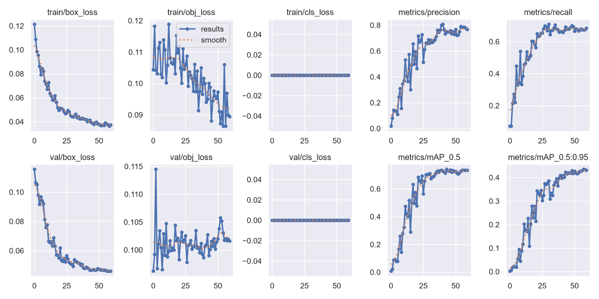
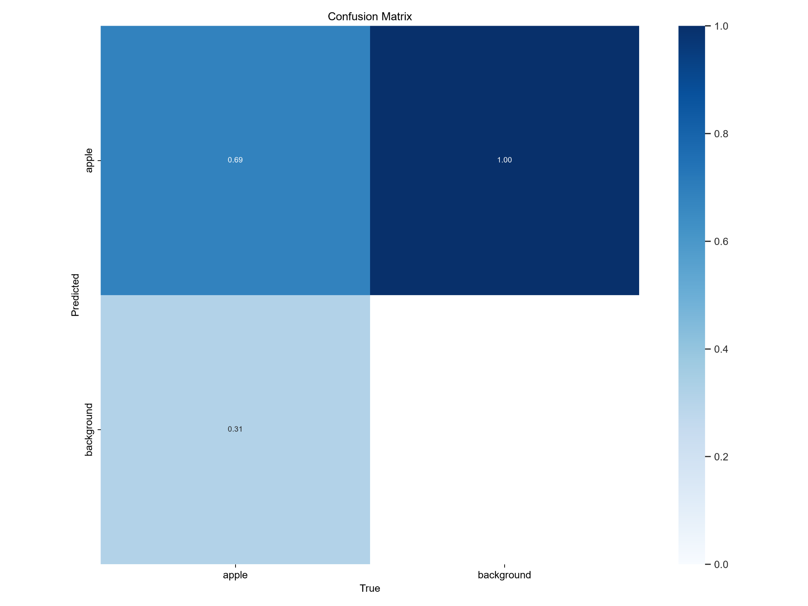

# AppleDetecting 🍎

**Computer vision and mathematical modeling for apple detection, maturity grouping, monocular depth estimation, and an experimental mass proxy.**

A reproducible reconstruction of **APMCM 2024 Problem A (Questions 1–4)**, developed as a Python research application for Windows and NVIDIA GPUs. **Question 5 is intentionally out of scope.**



## Capabilities

| Component | Implementation | Output |
|---|---|---|
| Detection & counting | Fine-tuned YOLOv5s | Bounding boxes, count, confidence |
| Localization | Image-coordinate transform | Centers with bottom-left origin |
| Maturity | HSV H/S histograms + spectral clustering | Raw / Fully Mature / Half Mature (user-defined cluster mapping) |
| HSV research plots | Training-crop histograms | Hue polar sectors, S/V color-filled bars |
| Depth | Pretrained ZoeDepth-NK | Heatmap, per-apple median estimated depth |
| Mass proxy | Competition-inspired geometry and density | **Uncalibrated proxy, not grams** |

## Quick start (Windows / Anaconda Prompt)

Prerequisites: Python 3.11 Conda environment, CUDA-enabled PyTorch, official YOLOv5 checkout and a local ZoeDepth checkout. **Do not commit model weights or image datasets.**

```cmd
conda activate appledetecting
cd /d PATH_TO_YOUR_CLONED_REPOSITORY
python -m pip install -e ".[dev]"
python scripts\check_environment.py
python -m streamlit run app\main.py
```

Expected local files:

```text
AppleDetecting/
├── app/main.py
├── src/appledetecting/
├── scripts/
├── configs/
├── models/cluster_names.json
├── models/maturity_reference.npz       # generated locally, ignored by Git
├── external/yolov5/                   # clone separately, ignored by Git
├── external/ZoeDepth/                  # clone separately, ignored by Git
├── runs/train/apple_pseudo_v1/weights/best.pt   # local checkpoint, ignored by Git
├── datasets/apple_pseudo/              # private source images/labels, ignored by Git
├── assets/                              # historical plots and metrics
└── docs/
```

See [Windows setup](docs/WINDOWS_SETUP.md), [experiment methodology](docs/METHODOLOGY.md), and [reproducibility/limitations](docs/REPRODUCIBILITY.md).

## Train or reproduce

```cmd
scripts\train_detector.cmd
scripts\test_detector.cmd
python scripts\fit_maturity.py --dataset datasets\apple_pseudo --out models\maturity_reference.npz --max-crops 100000
```

The training dataset contains **historical unreviewed pseudo-labels**. Metrics below are agreement with those labels, **not ground-truth detection accuracy**.

### Held-out pseudo-label test (31 images, 373 instances)

| Precision | Recall | mAP@50 | mAP@50–95 |
|---:|---:|---:|---:|
| 0.872 | 0.784 | 0.859 | 0.543 |



## Reproducibility and limitations

- Original competition paper used **YOLOv5x**, but this reconstruction trained **YOLOv5s** on the RTX 4060 Laptop GPU. They are not the same model or experiment.
- HSV clusters are unsupervised. The mapping `0=Raw`, `1=Fully Mature`, `2=Half Mature` is a **user interpretation**, not a validated ripeness classifier. Re-fitting clustering can permute IDs.
- ZoeDepth estimates are not guaranteed metric-accurate on orchard photographs.
- The mass calculation is a historical heuristic requiring camera scale and measured masses for physical calibration; **do not report its output as grams**.
- Original dataset images and external weights are excluded for licensing, privacy, and size reasons.

## Tests

```cmd
python -m pytest -q
```

## License

MIT license covers **newly authored source code only**. The original competition report, source images, pretrained models, and upstream YOLOv5/ZoeDepth code retain their respective rights and licenses. Review these separately before redistributing.

## Authorship, acknowledgments and publication

AppleDetecting grew out of a team-authored submission to **2024 APMCM, Problem A**. The competition research and original report were collaborative work. The current repository is a subsequent software reconstruction, with a different YOLOv5s baseline, new engineering infrastructure, and an interactive demo. It should not be interpreted as an exact reproduction of the original YOLOv5x experiments.

The original report is included at [docs/original_report.pdf](docs/original_report.pdf) with the team's agreement to publish. **The report is not covered by this repository's MIT software license.** The team retains its authorship; citations, figures and other third-party content in the report may have separate rights. Please see [Attribution and rights](docs/ATTRIBUTION.md) and the [Public release checklist](docs/PUBLICATION.md). No dataset or model checkpoint redistribution rights are implied by inclusion of code or results.

If you use this project in academic work, credit the original APMCM team for the competition research and distinguish it from the subsequent software implementation. Full contributor names are not published here without their approval.
